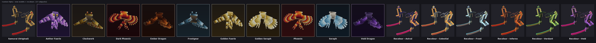

# Custom-Elytra

Sebuah Texture/Resource Pack skin custom elytra untuk **Minecraft Bedrock Edition**.

Pack ini berisi dua jenis skin:

- **Model baru dari nol** — geometri 3D + tekstur yang digambar sendiri, bentuk
  sayapnya beda total dari samurai (`tools/build_designs.py`).
- **Recolour samurai** — model samurai asli dengan palet warna digeser
  (`tools/generate_variants.py`), supaya desain asli tetap ada.

Semua skin dipilih di dalam game lewat **Pack Settings**, tidak perlu ganti file.



## Daftar skin

### Model baru (asset baru, bukan recolor)

| Subpack | Bentuk | Nuansa |
| --- | --- | --- |
| `Phoenix` | Sayap burung api berlapis bulu + ekor menjuntai | Merah-oranye-emas |
| `Dark Phoenix` | Sama, palet malam | Merah tua, jingga, krem |
| `Seraph` | Sayap malaikat kristal melengkung + pita cahaya | Es biru-putih |
| `Golden Seraph` | Sama, versi emas suci | Emas-putih |
| `Void Dragon` | Sayap kelelawar/naga: tulang + membran teregang | Ungu void |
| `Ember Dragon` | Sama, palet bara | Cokelat-oranye |
| `Aether Faerie` | 4 sayap kupu-kupu: forewing besar + hindwing menggantung, veins iridescent | Ungu-lavender |
| `Golden Faerie` | Sama, versi emas | Emas-krem |
| `Clockwork` | Sayap mekanik: lamela kuningan/tembaga bertumpuk + gear hub + piston | Kuningan-tembaga |
| `Frostgear` | Sama, versi dingin | Baja-biru es |

### Recolour samurai

| Subpack | Nuansa |
| --- | --- |
| `Samurai (Original)` | Hitam-emas + bilah merah (default, tidak diubah) |
| `Recolour - Frost` | Es |
| `Recolour - Inferno` | Api |
| `Recolour - Void` | Void |
| `Recolour - Verdant` | Hijau lumut |
| `Recolour - Astral` | Indigo-pink |
| `Recolour - Celestial` | Perak-emas |

## Cara pakai

1. Build pack-nya:

   ```bash
   python3 tools/build_pack.py      # atau pakai dist/ yang sudah ada
   ```

   Hasilnya: `dist/Skin-Custom-Elytra.mcpack`.

2. Import `.mcpack` ke Minecraft (klik dua kali di Windows, atau *Open with →
   Minecraft* di Android/iOS).
3. Aktifkan pack di **Settings → Global Resources**.
4. Ganti skin: **Settings → Global Resources → paket ini → ikon gerigi
   (Pack Settings) → pilih skin → Done**. Skin aktif langsung berubah.

Saat pertama dipasang pack otomatis memakai **Samurai (Original)** — tampilan
elytra tidak berubah sampai kamu memilih skin lain. Bedrock memilih subpack
dengan `memory_tier` tertinggi sebagai default, jadi `original_samurai` sengaja
ditulis paling akhir dengan tier tertinggi.

## Struktur

```
Custom Elytra/
├── manifest.json               # uuid pack + daftar 13 subpacks
├── attachables/elytra.json     # pasang tekstur ke elytra vanilla (default)
├── models/mobs.json            # geometry.elytra (model samurai asli)
├── animations/                 # animasi model asli
├── animation_controllers/
├── textures/models/intity/samurai.png
└── subpacks/
    ├── phoenix/                # model baru: models/ + attachables/ +
    │                           # animations/ + tekstur + pack_icon sendiri
    ├── seraph/ dragon/ ...
    ├── fantasy_*/              # recolour: hanya override tekstur + ikon
    └── original_samurai/
```

Subpack model baru bersifat *self-contained*: ia membawa geometry, attachable,
animasi dan teksturnya sendiri, jadi bisa juga dipakai sebagai pack terpisah.
Subpack recolour cukup menimpa tekstur, sehingga otomatis memakai model asli.

## Mengembangkan

```bash
python3 tools/build_pack.py        # generate semua subpack + manifest + mcpack
python3 tools/build_pack.py --skip-render   # tanpa render ulang ikon (cepat)
python3 tools/validate_pack.py     # cek manifest, geometri, tekstur, animasi
python3 tools/render_model.py --geometry "Custom Elytra/models/mobs.json" \
    --texture "Custom Elytra/textures/models/intity/samurai.png" --out /tmp/x.png
```

### Menambah model baru

Semua di `tools/build_designs.py`:

```python
m = Model("geometry.elytra", atlas_size=256, texture_width=256, texture_height=256)
body = m.bone("body", pivot=[0, 24, 0])
wing = m.bone("my_wing_l", pivot=[2.1, 25.3, 1.6], parent="body")
m.feather(wing, pivot=[1.95, 25.5, 1.95], length=9.0, width=1.5,
          thickness=0.38, palette=pal, sweep=40, droop=34,
          dir=1, style="barb", faces=("north", "south"))
```

- `wingkit.py` — atlas tekstur otomatis (shelf packer), painter procedural
  (`grad`, `facet`, `barb`, `leaf`, `crystal`, `spot`), helper `feather()` yang
  mengurus mirroring kiri/kanan.
- `dir=1` untuk sayap kanan model (sisi +x), `dir=-1` untuk yang kiri.
- `faces=(...)` memilih sisi cube yang dibuat; untuk lempengan tipis pakai
  `("north", "south")` supaya tidak ada sisi jarum yang ikut terlihat.
- `compact=True` memakai unwrap ringkas untuk cube kecil (gear, rivet, gem),
  supaya atlas 256×256 tidak cepat penuh.
- Painter yang tersedia: `grad`, `facet`, `barb`, `leaf`, `crystal`, `spot`,
  `iris` (membran kupu-kupu), `rivet` (pelat logam).
- Tekstur 256×256 dengan 1 unit uv = 1 px (kualitas 4 px per unit model);
  angka ini bisa dinaikkan ke 512 kalau butuh lebih tajam.

Butuh `pillow` dan `numpy` (`pip install pillow numpy`).

## Catatan teknis

- `min_engine_version` diset `[1, 21, 0]`. Nilai lebih tinggi dari versi game
  membuat pack **tidak muncul sama sekali** di Global Resources.
- Atlas tekstur mengalokasikan blok dari ukuran face yang sudah dibulatkan,
  karena rect UV yang melebihi blok-nya dulu dilewati dan membuat face
  transparan (geometri tidak terlihat). `validate_pack.py` sekarang gagal kalau
  ada face model buatan repo ini yang menunjuk piksel transparan.
- Attachable default di pack asli merujuk
  `controller.animation.elytra.default`, yang tidak ada di file
  `animation_controllers` (isinya `controller.animation.elytra`). Subpack model
  baru memakai controller dengan nama yang benar beserta animasi yang namanya
  cocok; subpack recolour mengikuti model asli apa adanya.

## Kredit

- Model & tekstur samurai asli: **xVoid Axell**
- Model Phoenix / Seraph / Dragon: dibuat dari nol di repo ini
